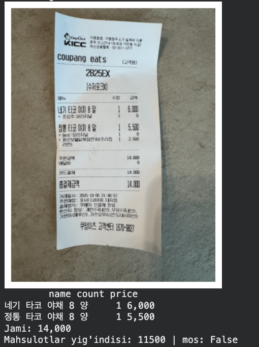
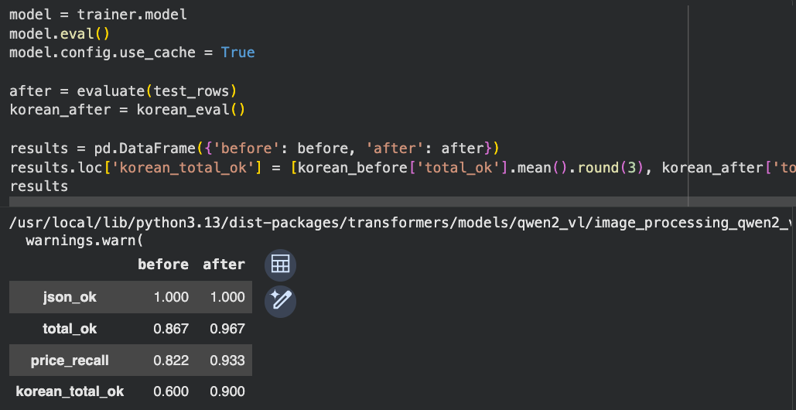

# Receipt Reader

Reads a photo of a store receipt and returns the purchased items, their prices and the total as JSON.

The model is **Qwen2-VL-2B-Instruct**, fine-tuned with **QLoRA** (4-bit base model + LoRA adapter) on 400 receipts from the
[CORD v2](https://huggingface.co/datasets/naver-clova-ix/cord-v2) dataset (Indonesian receipts), then tested on real **Korean** receipts.
Everything runs in one Colab notebook on a free T4 GPU.



*Model output on a Korean receipt: the total (14,000) is correct; a 2,500 add-on item was missed, and the sum check flags it.*

## Results

The same test receipts were scored before and after fine-tuning.

| Metric | Before | After |
| --- | --- | --- |
| Valid JSON output (CORD test, n=30) | 100% | 100% |
| Total amount correct (CORD test, n=30) | 86.7% | **96.7%** |
| Item prices found (CORD test, n=30) | 82.2% | **93.3%** |
| Total amount correct (Korean receipts, n=20) | 60% | **90%** |



The Korean receipts come from [HumynLabs/Korean_Receipts_Dataset](https://huggingface.co/datasets/HumynLabs/Korean_Receipts_Dataset),
which has images only, so I read the 20 totals by hand to make the labels.
Both test sets are small; treat the numbers as a first measurement.

## What went wrong, and the fixes

1. **The first fine-tune made the model worse** (Korean accuracy dropped from 60% to 5%).
   All 827 tokens of an example were used as labels, and 726 of them were image placeholder tokens,
   so the model was learning to predict image tokens instead of the answer.
   Switching the dataset to the prompt/completion format with `completion_only_loss=True`
   limited the loss to the JSON answer (training loss went from about 16 to under 0.1).
2. **The T4 GPU does not support bfloat16** for this operation (it needs compute capability 8.0+).
   Moving to float16 fixed the error and made evaluation about 2.5× faster.
3. With fp16 mixed precision some LoRA weights were still bfloat16 and broke the gradient scaler;
   casting the trainable parameters to float32 fixed it.

## How it works

1. **Data**: CORD v2 receipts are turned into a prompt (receipt image + instruction) and a completion
   (JSON with `items: [{name, count, price}]` and `total`).
2. **Model**: `Qwen/Qwen2-VL-2B-Instruct` loaded in 4-bit NF4 with bitsandbytes, float16 compute.
3. **LoRA**: r=8, alpha=16, dropout 0.05 on `q_proj` and `v_proj` — 1.09M trainable parameters (0.05%).
4. **Training**: TRL `SFTTrainer`, 1 epoch, batch 1 × gradient accumulation 4 (100 steps), lr 2e-4, about 18 minutes on a T4.
5. **Evaluation**: valid JSON, exact total match and the share of true item prices found, on unseen receipts.
6. **Sum check**: the demo adds up the item prices and warns when they do not match the total.

## Repository

```
receipt_reader.ipynb   Colab notebook: data, baseline, QLoRA training, evaluation, demo (with outputs)
adapter/               trained LoRA adapter and processor settings
images/                screenshots used in this README
```

## Run it

Open `receipt_reader.ipynb` in Google Colab and choose **Runtime → Change runtime type → T4 GPU**.
The notebook mounts Google Drive (`USE_DRIVE = True`) so checkpoints and the adapter survive a disconnect.

To use the trained adapter without training again, load it on top of the base model
(the same code as section 9 of the notebook):

```python
import torch
from peft import PeftModel
from transformers import AutoModelForImageTextToText, AutoProcessor, BitsAndBytesConfig

bnb_config = BitsAndBytesConfig(load_in_4bit=True, bnb_4bit_quant_type='nf4',
                                bnb_4bit_use_double_quant=True, bnb_4bit_compute_dtype=torch.float16)
base = AutoModelForImageTextToText.from_pretrained('Qwen/Qwen2-VL-2B-Instruct', quantization_config=bnb_config,
                                                   device_map='auto', dtype=torch.float16)
processor = AutoProcessor.from_pretrained('adapter')
model = PeftModel.from_pretrained(base, 'adapter').eval()
```

Use the same prompt as in training (see `PROMPT` in the notebook) and `do_sample=False`.

## Credits

- Model: [Qwen2-VL-2B-Instruct](https://huggingface.co/Qwen/Qwen2-VL-2B-Instruct) (Apache 2.0)
- Training data: [CORD v2](https://huggingface.co/datasets/naver-clova-ix/cord-v2) (CC BY 4.0)
- Korean test receipts: [HumynLabs/Korean_Receipts_Dataset](https://huggingface.co/datasets/HumynLabs/Korean_Receipts_Dataset) (CC BY 4.0)
